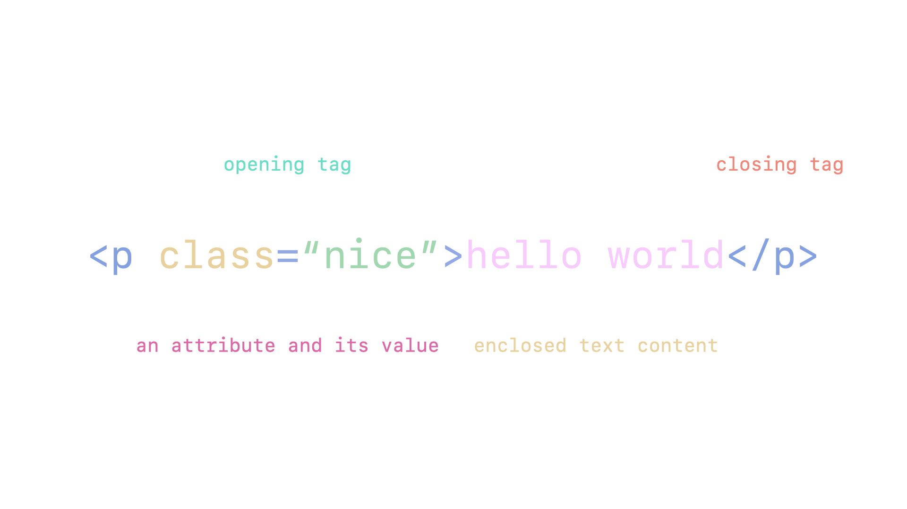

# reference guide and refresher for html+css

```html
<!--
          :root {
            --color-0: #0A0A0A;
            --color-1: #141414;
            --color-2: #1F1F1F;
            --color-3: #292929;
            --color-4: #333333;
            --color-5: #3D3D3D;
            --color-6: #474747;
            --color-7: #525252;
            --color-8: #5C5C5C;
            --color-9: #666666;
            --color-A: #707070;
            --color-B: #7A7A7A;
            --color-C: #858585;
            --color-D: #8F8F8F;
            --color-E: #999999;
            --color-F: #A3A3A3;
            --color-G: #ADADAD;
            --color-H: #B8B8B8;
            --color-I: #C2C2C2;
            --color-J: #CCCCCC;
            --color-K: #D6D6D6;
            --color-L: #E0E0E0;
            --color-M: #EBEBEB;
            --color-N: #F5F5F5;
            --color-O: #FFFFFF;
          }
      -->
<main>
  <!-- comment                                  -->
  <!-- <p class="nice">hello world</p>          -->
  <!--                                          -->
  <!-- <p class="nice">   opening tag           -->
  <!-- class="nice"       attribute = value     -->
  <!-- hello world        enclosed text content -->
  <!-- </p>               closing tag           -->

  <!-- `<nav>` an element that represents a 
        section of a page whose purpose 
        is to provide navigation links, 
        either within the current 
        document or to other documents.
        common examples of navigation 
        sections are menus, tables of 
        contents, and indexes.

      -->
  <nav class="nav">
    <ul>
      <h1>morganbergen.com</h1>
      <p><a href="google.com">google</a></p>
    </ul>
  </nav>
</main>
```

hypertext markup language is a markup language that tells web browsers how to structure the web pages you visit. html consists of a series of elements,

anatomy of an html element



html is the most basic building block of the web. it defines the meaning and structure of web content. other technologies besides html are generally used to describe a web page's appearances/presentation (css) or functionality/behavior (javascript).

hypertext referes to links that connect web pages to one another, either within a single website or between websites. links are a fundamental aspect of the web. by uploading content to the internet and linking it to pages created by other people, you become an active participant in the world wide web.

html uses markup to annotate text, images, and other content for display in a web browser. html markup includes special elements.

https://www.iimchyderabad.com/Material/html.pdf

```html
<head>

<title>

<body>

<header>

<footer>

<article>

<section>

<p>

<div>

<span>


<aside>

<audio>

<canvas>

<datalist>

<details>

<embed>

<nav>

<search>

<output>

<progress>

<video>

<ul> `unordered list`

<ol> `ordered list`

<li> `list item`
```

an html element is set off from other text in a document by tags, which consist of the element name surrounded by `<` and `>`. the name of an element inside a tag is insensitive. that is, it can be written in uppercase, lowercase, or a mixture. for example, the `<title>`.

- the anatomy of an html element - element, opening tag, content, closing tag, attributes
- the html body and its purpose as a container for the page content
- what void elements are, and how they differ from other elements
- the need for a doctype at the top of html documents, including its original intended purpose, and the fact that it is now somewhat of a historical artifact.
- understanding that html needs to be correctly nested

html consists of a series of elements, which you use to enclose, wrap, or mark up different parts of content into a hyperlink to link to another page, italicize words, and so on. for example, consider the following line of text:

```html
my cat is v ery grumpy

<p>my cat is very grumpy</p>

<h1>my cat is very grumpy</h1>
```
